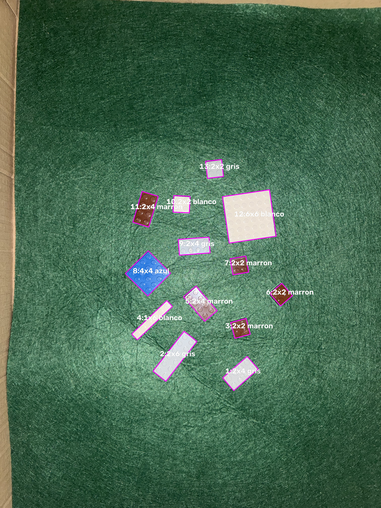

# Visión Artificial Clásica: inventario de piezas LEGO

Reto 07 (examen parcial). Sistema de visión artificial **clásica**, sin deep learning ni
clasificadores entrenados, que analiza una foto cenital de piezas LEGO sobre un tapete verde:

1. **Detección:** localiza todas las piezas.
2. **Identificación:** asigna a cada pieza su **tipo** (tamaño en tetones) y su **color**
   mediante un árbol de decisión. Clase final = tipo + color, por ejemplo `2x4 marron`.
3. **Interpretación:** genera el inventario automático por tipo y color.

**Vídeo demo:** https://youtu.be/joAlEJc477Q · **Trabajo escrito:** [Trabajo_Reto07_LEGO.pdf](Trabajo_Reto07_LEGO.pdf)



## Pipeline

```
Foto RGB -> suavizado -> HSV / Lab -> máscara del tapete verde -> piezas = (zona tapete) AND (no verde)
-> apertura/cierre morfológico -> contornos -> filtros (borde, área, ancho, rectangularidad)
-> características (rectángulo orientado en mm, mediana Lab/V sin reflejos)
-> árbol de decisión (tamaño + color) -> inventario
```

## Árbol de decisión

**Tamaño:** ancho y largo del rectángulo de área mínima, en mm (escala fija de 8 px/mm),
convertidos a número de tetones. Cada umbral está a mitad de camino entre los grupos medidos:

| Tetones | Medido (mm) | Umbral superior |
|---|---|---|
| 1 | 6,9 – 12,3 | 13,5 |
| 2 | 15,0 – 17,7 | 23,5 |
| 4 | 29,5 – 32,4 | 39,0 |
| 6 | 46,0 – 50,1 | 55,0 |
| 8 | 60,4 – 63,2 | 70,0 |

**Color:** Lab de OpenCV (a\*, b\* centrados en 128) y brillo V de HSV:

```
b* < 110 ............................ azul      (azul 72-105 | resto >= 122)
a* > 160 ............................ rojo      (rojo 172-187 | marrón <= 153)
a* > 132 -> V > 220 ................. rosa      (rosa V 249)
         -> si no ................... marron    (marrón V <= 200)
b* > 178 ............................ amarillo  (amarillo 196-198 | beige <= 160)
b* > 145 ............................ beige     (beige 156-160 | blanco <= 135)
V  < 190 ............................ negro     (negro 13-173 | blanco/gris >= 208)
b* >= 130 o V > 245 ................. blanco    (blanco 132-135 | gris <= 128)
si no ............................... gris
```

## Resultados

`python evaluar.py` compara el inventario detectado con el real, anotado a mano:

**13 fotos, 7 escenas distintas, 135 piezas: 135/135 aciertos (100 %), 0 falsos positivos.**

(`IMG_4178` se excluye a propósito: está tomada más cerca, con otra escala.)

## Uso

```bash
pip install -r requirements.txt
python lego.py                    # abre un diálogo para elegir la foto
python lego.py fotos/IMG_4176.jpg # o se le pasa la ruta
python evaluar.py                 # medida cuantitativa de aciertos
```

Admite JPG, PNG y HEIC (iPhone). Saca la tabla de características de cada pieza y el
inventario, y guarda `<foto>_resultado.jpg` con las piezas etiquetadas.

### Ejecutable para Windows (opcional)

```bash
pip install pyinstaller
pyinstaller --onefile --console --name LEGO --collect-all pillow_heif lego.py
```

## Montaje y condiciones

- Tapete de fieltro verde mate; cámara del móvil (iPhone, 4032×3024) en cenital y **siempre a la
  misma altura**, porque la escala de 8 px/mm es fija. La pieza más pequeña (1x1, unos 8 mm)
  ocupa unos 60 px.
- Lámpara como iluminación principal.

## Limitaciones

- Si cambia la altura de la cámara, cambia la escala y los tamaños salen mal.
- Las piezas no deben tocarse entre sí: se detectarían como una sola.
- Las piezas verdes no se distinguen del tapete.
- El negro es sensible a la iluminación (V entre 13 y 173), y marrón frente a beige tiene poco
  margen en a\* (133 frente a 131).
- Los tamaños no medidos (por ejemplo 2x3) se asignan al tamaño de catálogo más cercano.

## Archivos

| Archivo | Contenido |
|---|---|
| `lego.py` | Programa principal (segmentación, características, árbol, inventario) |
| `evaluar.py` | Evaluación cuantitativa con las escenas anotadas |
| `fotos/` | Fotos de prueba |
| `ejemplo_resultado.jpg` | Ejemplo de salida |
